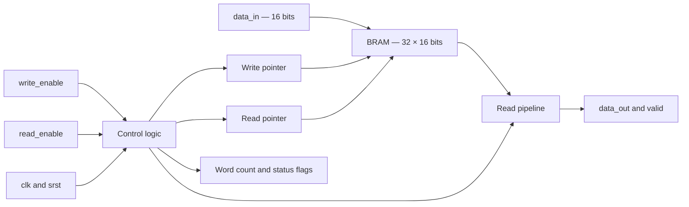

# ECE 520 Lab 3 — BRAM FIFO

## Overview

This lab implements a single-clock FIFO in Verilog using FPGA block RAM.
The FIFO stores 32 words, with 16 bits per word. Separate read and write
pointers keep the data in first-in, first-out order.

The design includes a synchronous reset, registered read data, a valid
signal, full and empty flags, almost-full and almost-empty flags, and a
count of the words currently stored.

Writes are rejected when the FIFO is full, and reads are rejected when
it is empty. When a read and write both succeed, the count stays unchanged.

## Block Diagram



## Read Timing

With the default READ_LATENCY = 1, an accepted read loads the first
pipeline stage. The output data and valid signal update on the following
rising clock edge.

## Simulation Tests

1. Reset clears the count, output, and valid signal and sets the empty flags.
2. Fixed data patterns are read back in the original order.
3. Filling the FIFO checks full, almost_full, and the word count.
4. A write while full is rejected without overwriting stored data.
5. A read while empty is rejected without producing valid data.
6. A simultaneous read and write returns the oldest word and preserves the count.
7. Python-generated input data is checked, including pointer wraparound.

The updated simulation completed at 6031 ns and printed ALL TESTS PASSED.

## Repository Files

- src/sc_fifo.v — FIFO hardware
- sim/tb_sc_fifo.v — testbench
- sim/input_data.txt — generated simulation input
- scripts/generate_fifo_data.py — input-data generator
- scripts/create_project.tcl — Vivado project creation and automation
- reports/synthesis.log — synthesis log
- reports/resource_utilization.rpt — resource utilization report

## Running the Lab

Use Python 3 and Vivado 2023.1.

From the repository folder, generate the input data:

```bash
python scripts/generate_fifo_data.py
```

In Vivado, close any open project. Run the following in the Tcl Console,
replacing the example path with the location of your repository:

```tcl
source {C:/path/to/ECE520_Lab3_BRAM_FIFO/scripts/create_project.tcl}
```

The script creates the project in vivado_demo, runs synthesis, saves the
reports, and runs the simulation.

The vivado_demo folder must not already contain a project when creating
a fresh demonstration project.

## Synthesis Results

The previously inspected utilization report showed one RAMB18E1 block.
The reports folder contains the synthesis log and resource utilization
report for review.

## References

- ECE 520/L Lab 3 instructions and course lecture notes.
